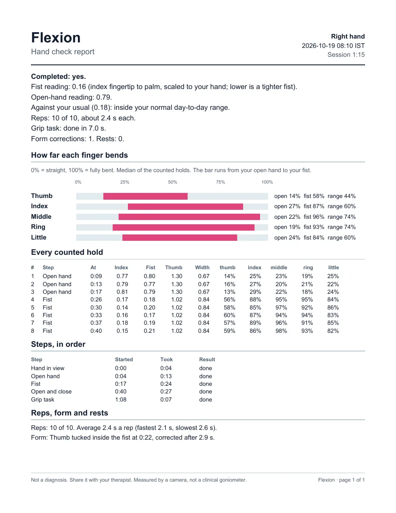
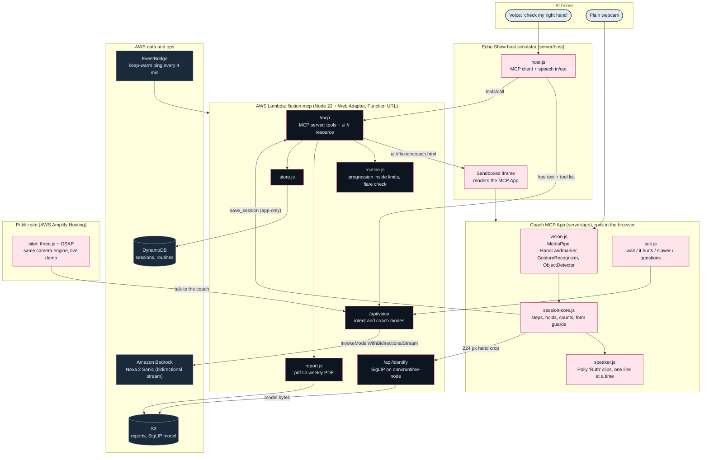
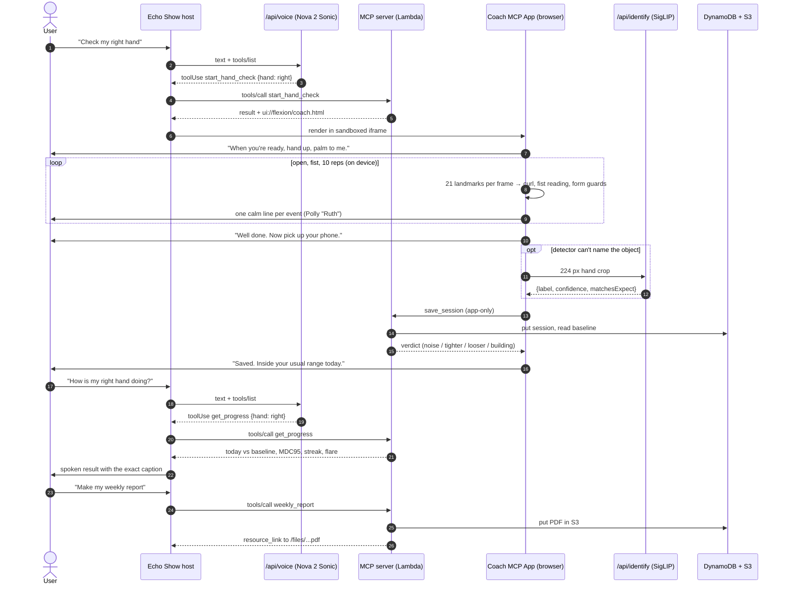
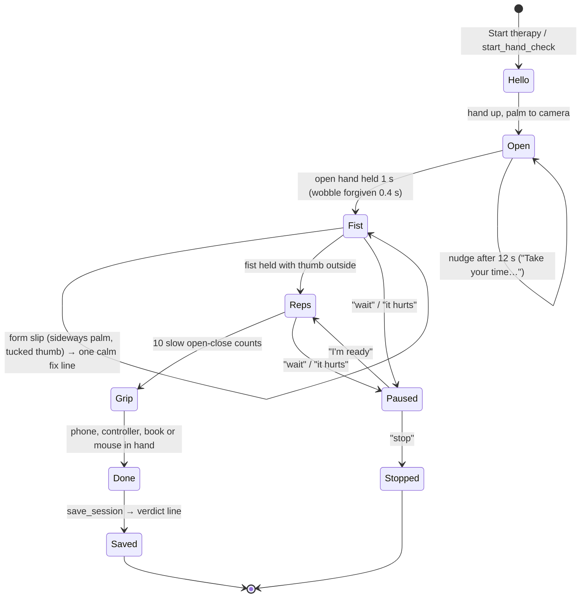

# Flexion

<p align="center">
  
  
  
  
  <a href="LICENSE"></a>
</p>

<p align="center">
  <a href="https://main.d171bf7qqki4nj.amplifyapp.com/"></a>
</p>

---

> **Your hand therapist's eyes at home.**
> Alexa leads a two-minute morning hand check by voice while a plain webcam measures how far each finger curls.
> A reading only counts as real change when it leaves the measured noise band (MDC95), the routine only grows inside
> the limits the therapist wrote, and every Monday the therapist gets the week on one page.
>
> A measurement aid, not a diagnosis. Built for **Build, Ship, Shape: Amazon Developer Hackathon** (Alexa+ track).

| Try it | Link |
|---|---|
| Live site (with an in-browser camera demo) | https://main.d171bf7qqki4nj.amplifyapp.com/ |
| Echo Show host simulator | https://ajsz3ao7tetyacjcyputpsz2mm0edogp.lambda-url.us-east-1.on.aws/host/index.html |
| MCP endpoint (Streamable HTTP) | https://ajsz3ao7tetyacjcyputpsz2mm0edogp.lambda-url.us-east-1.on.aws/mcp |
| How the numbers are measured | https://main.d171bf7qqki4nj.amplifyapp.com/method.html |

---

## Table of Contents

- [The Problem: Home Exercises Happen Blind](#the-problem-home-exercises-happen-blind)
- [What Flexion Does](#what-flexion-does)
- [System Architecture](#system-architecture)
- [Hand Check Sequence](#hand-check-sequence)
- [Coach Session State Machine](#coach-session-state-machine)
- [Measurement: the Fist Reading and the Noise Band](#measurement-the-fist-reading-and-the-noise-band)
- [Verdicts and the Therapist's Fence](#verdicts-and-the-therapists-fence)
- [MCP Surface](#mcp-surface)
- [Amazon and AWS Services](#amazon-and-aws-services)
- [Measured Performance](#measured-performance)
- [Privacy, Safety and Guardrails](#privacy-safety-and-guardrails)
- [What Is Live and What Is Not Yet](#what-is-live-and-what-is-not-yet)
- [Installation and Quickstart](#installation-and-quickstart)
- [Deploy to AWS](#deploy-to-aws)
- [Configuration](#configuration)
- [Testing](#testing)
- [Repository Structure](#repository-structure)
- [License and Author](#license-and-author)

---

## The Problem: Home Exercises Happen Blind

After a hand injury or surgery, most of the recovery work happens at home: the same open-hand, fist and grip exercises,
several times a day, for weeks. The therapist sees the hand once every week or two.

- **Nobody sees the in-between days.** A patient can't tell whether today's fist is really tighter or just a good morning.
- **Day-to-day noise looks like progress.** The same fist, made ten times, never reads the same twice. Without a measured
  noise floor, every small change looks meaningful, in either direction.
- **Doing too much is as risky as doing too little.** Routines are meant to progress inside limits the therapist sets
  (repetitions, hold times, range targets), and a home app that pushes past them is worse than none.

Flexion turns the morning routine into a measured, voice-led check that respects those limits and sends the week back
to the therapist.

---

## What Flexion Does

| Step | What happens | Where it runs |
|---|---|---|
| 1. Ask | "Alexa, check my right hand." Nova 2 Sonic picks the `start_hand_check` tool. | Echo Show host + `/api/voice` on Lambda |
| 2. Coach | The coach opens on the Echo Show screen as an MCP App and talks the user through open hand, fist, 10 reps and a grip task, one calm line at a time (Amazon Polly, voice Ruth). | In the browser, on the device |
| 3. Measure | MediaPipe reads 21 landmarks per hand, every frame, and turns them into per-finger curl plus the fist reading. Form guards catch a sideways hand or a tucked thumb. | On the device GPU |
| 4. Check the grip | For the grip task, the on-device detector looks for the phone (or a controller, book or mouse); SigLIP on the server names anything it can't. | Browser + Lambda |
| 5. Save and compare | `save_session` stores the session and compares the fist with the user's own baseline: noise, tighter, looser, or still building a baseline. | Lambda + DynamoDB |
| 6. Talk back | "How is my right hand doing?" → `get_progress`. Mid-session: "wait", "it hurts", "slower", or any question to the coach (Nova 2 Sonic, two short sentences). | Lambda |
| 7. Report | "Make my weekly report." → `weekly_report` builds a one-page PDF for the therapist: each day against the usual band, flare days, the therapist's limits, a signature line. | Lambda + S3 |

<p align="center">
  
</p>

---

## System Architecture



Three ideas carry the design:

1. **The camera never leaves the device.** Hand tracking, curl maths, form guards and counting all run in the browser.
   The only image that ever reaches the server is a 224 px crop around the hand during the grip step, when the
   on-device detector can't name the object.
2. **Alexa is the conversation, the MCP App is the instrument.** The voice layer only picks tools and speaks results;
   everything measured comes from the coach view and the server's plain functions, with exact captions.
3. **The therapist stays in charge.** Progression, flare calls and the weekly page all read the therapist's limits and
   the measured noise floor, never a model's opinion.

---

## Hand Check Sequence



If Sonic is unreachable, the host falls back to keyword rules (`intentOf` in `server/host/host-core.js`) and browser
speech, so a check never depends on the voice model being up.

---

## Coach Session State Machine



Timing rules that keep it humane (all in `server/app/session-core.js` and `speaker-core.js`): every step settles for
3 s before anything counts, holds are 1 s with a 0.4 s wobble allowance, 1.5 s rest between counts, fixes are only
spoken after a slip lasts 1.5 s, lines are never cut off, and there is a 1.2 s breath between lines.

---

## Measurement: the Fist Reading and the Noise Band

The fist reading works in plain 2D webcam coordinates, so it needs no depth camera:

$$
r_{\text{fist}} = \frac{\lVert p_{\text{index tip}} - p_{\text{index MCP}} \rVert}{\text{palm length}}
$$

where palm length is wrist to middle-finger knuckle. Two form guards make it repeatable:

| Guard | Rule | Why |
|---|---|---|
| Palm faces the camera | knuckle width ÷ palm length ≥ 0.45 | a sideways fist reads about 0.45 instead of 0.15 |
| Thumb outside the fist | thumb tip to little knuckle ÷ palm ≥ 0.6 | a tucked thumb stops the fingers closing (tucked fists read 0.21 to 0.35) |

**Validation run 4** (`spike/day1/data/run4-build4-confirm-G2.csv`): 10 re-formed fists with the hand taken out of frame
between each, plus 3 open hands, live in Chrome.

| Quantity | Value |
|---|---|
| Open hand reading | 0.766 |
| Fist reading, mean ± SD (n = 10) | 0.183 ± 0.023 |
| MDC95 = 1.96 × √2 × SD | **0.063** |
| MDC95 as a share of the open-to-fist range | **10.7 %** |
| Tracking speed | 30 fps, 3 to 5 ms a frame on the GPU |

A change smaller than the MDC95 is day-to-day noise, not progress. That single number drives the verdicts, the flare
check and the band printed on the weekly report.

---

## Verdicts and the Therapist's Fence

**After every session** (`progressOf` in `server/src/flexion.js`):

| Verdict | Condition | Spoken line |
|---|---|---|
| Building | fewer than 3 earlier sessions for this hand (the baseline is their median) | "Saved. A few more checks build your range." |
| Noise | today's fist within ± MDC95 of the baseline | "Saved. Inside your usual range today." |
| Tighter | fist closed further than baseline − MDC95 | "Saved. Your fist closed further than usual." |
| Looser | fist more open than baseline + MDC95 | "Saved. Your fist was looser than usual." |
| None | no valid fist captured | "Saved. No fist reading today." |

**Progression and flares** (`server/src/routine.js`):

| Rule | Value |
|---|---|
| Most a target may rise in one step | 10 %, at most once a week |
| Needed before any rise | 3 completed, pain-free sessions in a row |
| Ceiling | the therapist's written limit (max reps, max hold, range target); never passed |
| Flare | a measured drop beyond MDC95 on 2 days in a row, with at least 3 earlier sessions |
| On a flare | flagged by `get_progress` and on the weekly page; a routine can carry a `gentle` set for those days |
| Pain | "it hurts" pauses the session at once and says to rest and tell the therapist |

---

## MCP Surface

The server speaks MCP over Streamable HTTP (`@modelcontextprotocol/sdk` v2) and serves the coach as an MCP App
(`@modelcontextprotocol/ext-apps`).

| Tool | Visible to | Input | Returns |
|---|---|---|---|
| `start_hand_check` | model | `{ hand: "left" \| "right" }` | opens the coach view `ui://flexion/coach.html` |
| `get_progress` | model | `{ hand }` | last check vs the user's baseline, real change or noise, streak, flare |
| `weekly_report` | model | `{ hand, days ≤ 31 }` | a one-page therapist PDF as a `resource_link` |
| `save_session` | app only | the session log | stores it, returns the verdict |
| `identify_object` | app only | a 224 × 224 RGB crop + the expected objects | `{ label, confidence, matchesExpect }` |
| `ping` | model | none | health check |

| HTTP route | Purpose |
|---|---|
| `POST /mcp` | MCP Streamable HTTP |
| `POST /api/voice` | Nova 2 Sonic turn: `intent` mode picks a tool, `coach` mode answers in at most two short sentences |
| `POST /api/identify` | SigLIP object naming for the grip step |
| `POST /api/session` | the coach page's save path outside an MCP host |
| `GET /files/...` | report PDFs from the store |
| `GET /host/`, `GET /app/` | the Echo Show simulator and the standalone coach |
| `GET /healthz` | keep-warm target |

The site also publishes `/.well-known/ai-catalog.json` and `/llms.txt`, so agents can find the MCP endpoint.

---

## Amazon and AWS Services

| Service | Used for |
|---|---|
| **Amazon Nova 2 Sonic** (`amazon.nova-2-sonic-v1:0`, Bedrock bidirectional stream) | picks the right MCP tool from free speech; answers questions during a session |
| **Amazon Polly** (generative, voice Ruth) | the coach's 42 pre-rendered lines (`tools/voice/render.mjs`) |
| **AWS Lambda** + Lambda Web Adapter + Function URL | the MCP server, voice and identify routes (Node 22, 2048 MB) |
| **Amazon DynamoDB** | sessions and routines |
| **Amazon S3** | report PDFs, the SigLIP vision model |
| **AWS Amplify Hosting** | the public site (CDN, HTTPS) |
| **Amazon EventBridge** | a ping every 4 minutes keeps the function warm |
| **Amazon CloudWatch** | logs, identify scores, latency |
| **AWS Budgets** | a $10 a month alarm |
| **AWS IAM** | one least-privilege role: its logs, one table, one bucket, the Sonic stream |

| Model | Licence | Where it runs | Job |
|---|---|---|---|
| MediaPipe HandLandmarker, GestureRecognizer, EfficientDet-Lite2 ObjectDetector | Apache 2.0 | browser (WebGL/GPU) | 21 landmarks, gestures, held objects |
| SigLIP base patch16-224 (q8, ONNX) | Apache 2.0 | Lambda (onnxruntime-node) | names the object in the hand from 282 labels |
| Amazon Nova 2 Sonic | AWS | Bedrock, us-east-1 | tool choice and short spoken answers |

---

## Measured Performance

| What | Result | How it was measured |
|---|---|---|
| Hand tracking | 30 fps, 3 to 5 ms a frame | Chrome on a laptop GPU |
| `get_progress` round trip from India | p95 332 ms | `npm run latency` against the live `/mcp` |
| Server time per `/mcp` request | p50 3.9 ms, p95 10.7 ms | CloudWatch, 129 requests |
| First `initialize` with keep-warm | 1.0 s (2.78 s cold) | live, from India |
| Sonic tool choice | 1.1 to 1.7 s | live `/api/voice` |
| SigLIP identify, warm | p50 737 ms, p95 787 ms | 25 live calls |
| Site, mobile | LCP 0.96 s, CLS 0 | Lighthouse-style probe, slow 4G, 4× CPU |
| Site, Lighthouse | accessibility, best practices, SEO: 100 | desktop and mobile |
| Site frame time | p95 ≤ 16.7 ms in every section at 4× CPU | Chrome DevTools Protocol frame sampler |

---

## Privacy, Safety and Guardrails

- **Video stays on the device.** Tracking runs in the browser; the only image sent anywhere is one 224 px hand crop for
  object naming in the grip step. The site's live demo stays silent until the visitor starts a session.
- **Never names what you hold out loud.** The coach checks the object quietly; a failure just lets the session run on.
- **Pain stops everything.** "It hurts" pauses the session at once, with a line to rest and tell the therapist.
- **Not a diagnosis.** Flexion measures and reports; the therapist decides. Sample reports on the site are labelled as samples.
- **Server guards:** a Host and Origin allow-list, request size caps, per-client and global rate limits on the voice and
  identify routes, a strict CSP for the sandboxed coach frame, and least-privilege IAM.
- **No secrets in the repo.** Configuration comes from environment variable names only (below).

---

## What Is Live and What Is Not Yet

Honest status, so nothing here overclaims:

| Part | Status |
|---|---|
| MCP server, coach MCP App, Echo Show host simulator, site | **Live** on AWS |
| Nova 2 Sonic tool choice and coach answers | **Live** |
| SigLIP identify on Lambda | **Live** |
| Weekly therapist PDF and session PDF | **Live** |
| Real Alexa+ on a device | **Not yet.** The Echo Show host is a simulator built on the MCP Apps spec and calls the same public `/mcp` endpoint an Alexa+ integration would. The available Alexa+ developer bridge needs Bedrock text models, which this AWS account can't use until AWS finishes verifying it. |
| Therapist sheet → routine (Nova 2 Lite reads the exercise sheet) | **Written, not live**, for the same Bedrock reason (`spike/day1/nova_sheet.py`, `Routine` schema in `server/src/routine.js`). Demo targets are used meanwhile. |
| Accounts | One demo user; per-user ids arrive with account linking. |

---

## Installation and Quickstart

### Prerequisites

- Node.js 22.18 or newer
- Chrome or Edge with a webcam (for the camera parts)
- AWS CLI v2 with credentials (only to deploy, or to use Sonic and Polly locally)

### 1. Run the MCP server, the coach and the simulator

```bash
cd server
npm install
npm test
npm start
```

Open http://127.0.0.1:3001/ for the Echo Show simulator. Tick **Scripted hand** to run a full session with no camera,
or open http://127.0.0.1:3001/app/index.html for the coach on its own with a real camera.

### 2. Run the site

```bash
cd site
npm install
npm test
npm run dev
```

Add `?reduced` to any site URL to see the reduced-motion version.

### 3. Optional: object naming locally

Download the SigLIP vision model (`Xenova/siglip-base-patch16-224`, `onnx/vision_model_quantized.onnx`) and point
`FLEXION_SIGLIP_MODEL` at it before `npm start`. Without it, the grip step still passes on the on-device detector.

---

## Deploy to AWS

`server/scripts/deploy.mjs` creates or updates everything with the AWS CLI and is safe to run again. Without `--yes`
it only prints the plan.

```bash
cd server
node scripts/deploy.mjs              # print the plan
node scripts/deploy.mjs --yes        # table, bucket, role, Lambda + URL, keep-warm, site, budget
node scripts/deploy.mjs --yes --server-only
node scripts/deploy.mjs --yes --site-only
```

| Step | Creates |
|---|---|
| Store | DynamoDB table `flexion`, S3 bucket `flexion-data-<account>` |
| Server | IAM role, Lambda `flexion-mcp` with the Web Adapter layer, public Function URL |
| Model | `models/siglip-vision-q8.onnx` in the bucket, read-only for the function |
| Warmth | EventBridge rule `flexion-keep-warm` (every 4 minutes to `/healthz`) |
| Site | AWS Amplify Hosting app, built from `site/` |
| Cost | AWS Budgets alarm at $10 a month (set `BUDGET_EMAIL`) |

---

## Configuration

| Variable | Default | Purpose |
|---|---|---|
| `PORT` | `3001` | local port |
| `HOST` | `127.0.0.1` | bind address |
| `ALLOWED_HOSTS` | none | extra hostnames allowed as Host and Origin (a tunnel, the deployed site) |
| `PUBLIC_URL` | the bound host:port | the origin the coach view loads its modules from |
| `FLEXION_DATA` | `server/.data/` | local JSON store folder |
| `FLEXION_TABLE`, `FLEXION_BUCKET` | none | use DynamoDB + S3 instead of local files |
| `FLEXION_SIGLIP_MODEL` | none | local path to the SigLIP vision ONNX file |
| `SONIC_REGION` | `us-east-1` | Bedrock region for Nova 2 Sonic |
| `BUDGET_EMAIL` | none | where the budget alarm emails go (deploy only) |

---

## Testing

| Suite | Count | Covers |
|---|---|---|
| `server/` (`npm test`) | 186 passing, 1 skipped without the private photos | session flow and timing, form guards, voice lines, talk-back, verdicts, progression and flares, store (local and AWS behind mocks), report PDFs, MCP tools and routes, rate limits, Sonic stream parsing, identify scoring, the deploy zip |
| `site/` (`npm test`) | 43 passing | hand pose, noise band and fence maths, report pages, needle field, transition geometry, live camera labels |

`FLEXION_TEST_AWS=1 FLEXION_TABLE=… FLEXION_BUCKET=… npm test` runs the same store suite against a real table and
bucket and cleans up after itself.

---

## Repository Structure

```
flexion/
├── LICENSE                      # Apache License 2.0
├── README.md
├── server/
│   ├── src/
│   │   ├── server.js            # HTTP: /mcp, /api/voice, /api/identify, /api/session, /files, /host, /app
│   │   ├── flexion.js           # MCP tools, the coach resource, verdicts (progressOf), MDC95
│   │   ├── routine.js           # routine schema, progression inside limits, flare check
│   │   ├── report.js            # the weekly therapist PDF (pdf-lib)
│   │   ├── store.js             # local JSON or DynamoDB + S3 behind one interface
│   │   ├── voice.js             # Nova 2 Sonic bidirectional stream: intent and coach modes
│   │   ├── identify.js          # SigLIP image encoder on onnxruntime-node
│   │   ├── identify-core.js     # label scoring and the match verdict
│   │   ├── identify-labels.json # 282 label embeddings
│   │   └── limit.js             # rate limits
│   ├── app/                     # the coach MCP App (browser)
│   │   ├── vision.js            # MediaPipe models and the frame loop
│   │   ├── vision-core.js       # curl, fist reading, form guards (pure)
│   │   ├── session-core.js      # the session state machine (pure)
│   │   ├── speaker-core.js      # one line at a time, never cut off (pure)
│   │   ├── talk-core.js         # spoken commands during a session (pure)
│   │   ├── session-report.js    # one session's PDF
│   │   ├── lines.js             # every line the coach can say
│   │   └── voice/               # 42 Polly clips + manifest
│   ├── host/                    # the Echo Show host simulator (MCP client + app frame)
│   ├── scripts/                 # deploy, latency probe, sample PDFs
│   └── test/                    # node:test suites
├── site/
│   ├── index.html, method.html, 404.html
│   ├── src/core/                # scroll, preloader, transitions, heading reveals, cursor, nav
│   ├── src/scenes/              # the hand and dial, noise band, fence, grip putty, report page, live camera
│   ├── public/                  # fonts, sample PDFs, og image, llms.txt, ai-catalog.json
│   └── tests/
├── spike/day1/                  # the first measurement spike and its raw runs (data/*.csv)
└── tools/
    ├── siglip/                  # builds the label embeddings
    └── voice/                   # renders the coach lines with Amazon Polly
```

---

## License and Author

Licensed under the [Apache License 2.0](LICENSE). The bundled fonts (Anybody, Atkinson Hyperlegible Next and Mono) are
under the SIL Open Font License; their licence texts sit next to the font files.

Built by **Om Shukla** ([@omshukla24](https://github.com/omshukla24)).
