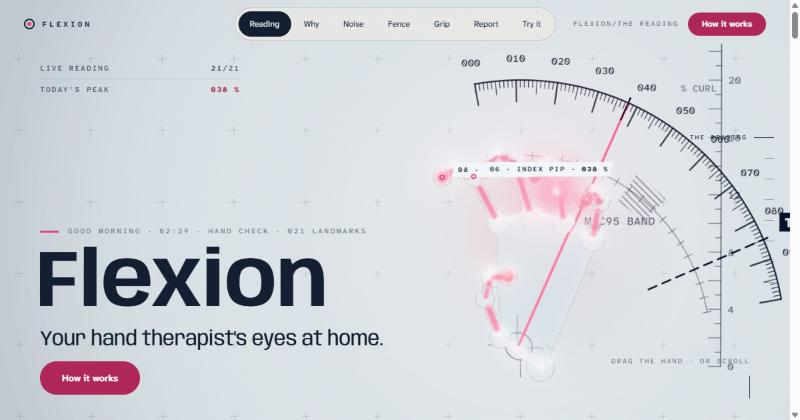
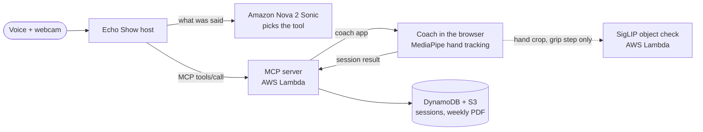
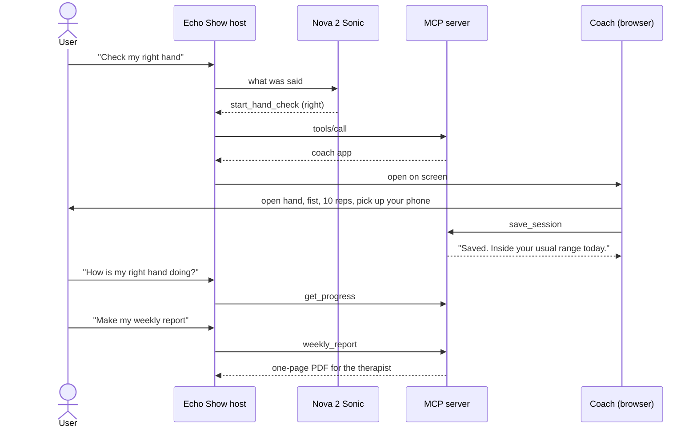

# Flexion

<p align="center">
  
  
  
  <a href="LICENSE"></a>
</p>

<p align="center">
  <a href="https://main.d171bf7qqki4nj.amplifyapp.com/"></a>
</p>

A two-minute morning hand check for people recovering from a hand injury. Alexa leads it by voice, a plain webcam
measures how far each finger curls, and the hand therapist gets the week on one page.

A change only counts when it is bigger than the noise of the reading itself: 10.7 % of the open-to-fist range, measured
over 10 repeated fists (`spike/day1/data`). The routine only grows inside the limits the therapist wrote.

Built for the Build, Ship, Shape: Amazon Developer Hackathon (Alexa+ track).

| | |
|---|---|
| Site | https://main.d171bf7qqki4nj.amplifyapp.com/ |
| Echo Show simulator | https://ajsz3ao7tetyacjcyputpsz2mm0edogp.lambda-url.us-east-1.on.aws/host/index.html |
| MCP endpoint | https://ajsz3ao7tetyacjcyputpsz2mm0edogp.lambda-url.us-east-1.on.aws/mcp |

## Architecture



## A hand check, start to finish



## Stack

| Part | Built with |
|---|---|
| Voice | Amazon Nova 2 Sonic for tool choice and questions, Amazon Polly (Ruth) for the coach |
| Hand tracking | MediaPipe in the browser; the video stays on the device |
| Object check | SigLIP on onnxruntime-node |
| Server | MCP server on Node 22, AWS Lambda, DynamoDB, S3 |
| Site | Vite, three.js, GSAP, AWS Amplify Hosting |

## Run it

```bash
cd server
npm install
npm test
npm start
```

Open http://127.0.0.1:3001/ for the Echo Show simulator. Tick "Scripted hand" to run a session without a camera.

```bash
cd site
npm install
npm run dev
```

To deploy, run `node scripts/deploy.mjs` from `server/` to see the plan, then again with `--yes`.

## Folders

| Folder | What's in it |
|---|---|
| `server/src` | MCP server, routine rules, store, weekly PDF |
| `server/app` | the coach that runs in the browser |
| `server/host` | the Echo Show simulator |
| `site` | the public site |
| `spike/day1` | the first measurement tests and their raw runs |
| `tools` | scripts that build the object labels and the coach's voice clips |

## Note

The Echo Show host is a simulator built on the MCP Apps spec and calls the same `/mcp` endpoint. Testing on a real
Alexa+ device needs Bedrock text models that this AWS account can't use yet.

## License

Apache 2.0. The bundled fonts are under the SIL Open Font License.
