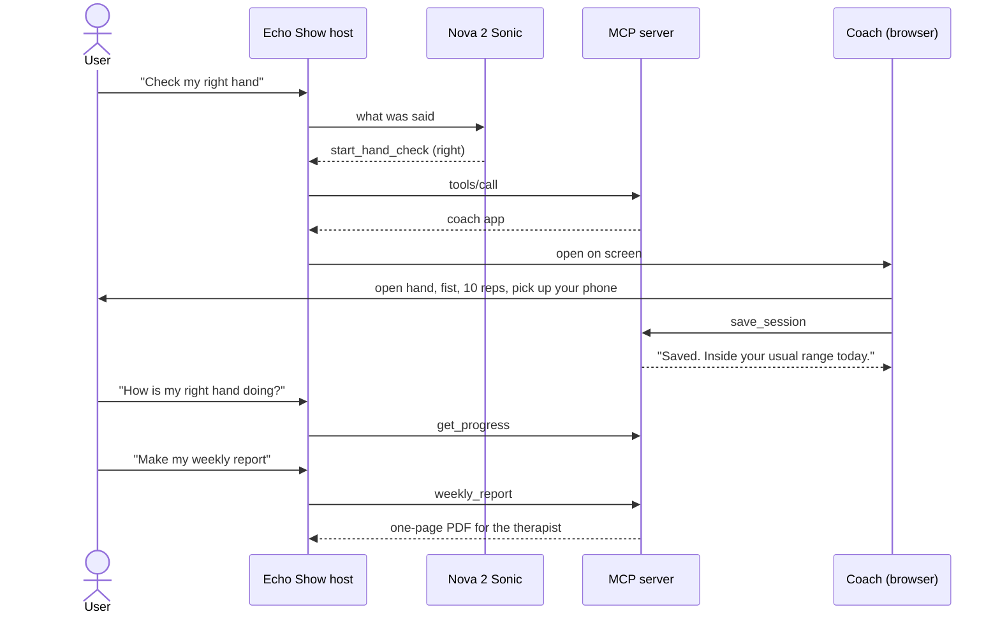

# Flexion

<p align="center">
  
  
  
  <a href="LICENSE"></a>
</p>

<p align="center">
  <a href="https://main.d171bf7qqki4nj.amplifyapp.com/"></a>
</p>

A two-minute morning hand check for people recovering from a hand injury. Alexa leads it by voice, a plain webcam
measures how far each finger curls, and the hand therapist gets the week on one page.

A change only counts when it is bigger than the noise of the reading itself: 10.7 % of the open-to-fist range, measured
over 10 repeated fists (`spike/day1/data`). The routine only grows inside the limits the therapist wrote.

Built for the Build, Ship, Shape: Amazon Developer Hackathon (Alexa+ track).

| | |
|---|---|
| Site | https://main.d171bf7qqki4nj.amplifyapp.com/ |
| Echo Show simulator | https://ajsz3ao7tetyacjcyputpsz2mm0edogp.lambda-url.us-east-1.on.aws/host/index.html |
| MCP endpoint | https://ajsz3ao7tetyacjcyputpsz2mm0edogp.lambda-url.us-east-1.on.aws/mcp |

## Architecture


## A hand check, start to finish



## Stack

| Part | Built with |
|---|---|
| Voice | Amazon Nova 2 Sonic for tool choice and questions, Amazon Polly (Ruth) for the coach |
| Hand tracking | MediaPipe in the browser; the video stays on the device |
| Object check | SigLIP on onnxruntime-node |
| Server | MCP server on Node 22, AWS Lambda, DynamoDB, S3 |
| Site | Vite, three.js, GSAP, AWS Amplify Hosting |

## Run it yourself

You need Node.js 22.18 or newer, and Chrome or Edge with a webcam for the camera parts.

**1. The MCP server, the coach and the Echo Show simulator**

```bash
git clone https://github.com/omshukla24/flexion.git
cd flexion/server
npm install
npm test
npm start
```

- http://127.0.0.1:3001/ opens the Echo Show simulator. Tick "Scripted hand" to run a whole session without a camera,
  or say or type "check my hand", "how did I do" and "make my weekly report".
- http://127.0.0.1:3001/app/index.html opens the coach on its own, with your real camera.
- Sessions are saved as JSON in `server/.data/`.
- With AWS credentials that can use Amazon Nova 2 Sonic in us-east-1, the simulator lets Sonic pick the tool. Without
  them it falls back to keyword matching, so everything still runs offline.
- Optional: point `FLEXION_SIGLIP_MODEL` at the SigLIP vision model
  (`Xenova/siglip-base-patch16-224`, `onnx/vision_model_quantized.onnx`) to name objects in the grip step on the server.

**2. The site**

```bash
cd flexion/site
npm install
npm test
npm run dev
```

Vite prints the local address. Add `?reduced` to any page to see the reduced-motion version. `npm run build` writes
`site/dist/`.

**3. Deploy to your own AWS account**

Needs the AWS CLI v2 with credentials. The script only prints its plan until you add `--yes`, and it is safe to run
again.

```bash
cd flexion/server
node scripts/deploy.mjs
node scripts/deploy.mjs --yes
```

It creates a DynamoDB table and an S3 bucket, the server on AWS Lambda behind a public Function URL, an EventBridge
ping that keeps it warm, the site on AWS Amplify Hosting, and a $10 a month budget alarm (set `BUDGET_EMAIL`).
`--server-only` and `--site-only` deploy one half.

## Repository structure

```
flexion/
├── server/
│   ├── src/
│   │   ├── server.js            # HTTP routes: /mcp, /api/voice, /api/identify, /api/session, /files, /host, /app
│   │   ├── flexion.js           # MCP tools and the coach app resource
│   │   ├── routine.js           # routine schema, progression inside the therapist's limits, flare check
│   │   ├── report.js            # the weekly therapist PDF
│   │   ├── store.js             # local JSON files, or DynamoDB + S3
│   │   ├── voice.js             # Amazon Nova 2 Sonic over the bidirectional stream
│   │   ├── identify.js          # SigLIP image encoder on onnxruntime-node
│   │   ├── identify-core.js     # label scoring
│   │   ├── identify-labels.json # 282 label embeddings
│   │   └── limit.js             # rate limits
│   ├── app/                     # the coach, runs in the browser
│   │   ├── vision.js            # MediaPipe models and the camera loop
│   │   ├── vision-core.js       # finger curl, fist reading, form checks
│   │   ├── session-core.js      # the session steps, holds and counts
│   │   ├── speaker.js           # plays the coach's lines one at a time
│   │   ├── talk.js              # "wait", "it hurts", "slower" and questions during a session
│   │   ├── session-report.js    # one session's PDF
│   │   ├── lines.js             # every line the coach can say
│   │   └── voice/               # the coach's Amazon Polly clips
│   ├── host/                    # the Echo Show simulator
│   ├── scripts/                 # deploy, latency check, sample PDFs
│   └── test/
├── site/
│   ├── index.html, method.html, 404.html
│   ├── src/core/                # scroll, loader, transitions, cursor, navigation
│   ├── src/scenes/              # hand and dial, noise band, fence, grip putty, report page, live camera
│   ├── public/                  # fonts, sample PDFs, images
│   └── tests/
├── spike/day1/                  # the first measurement tests and their raw runs (data/*.csv)
└── tools/
    ├── siglip/                  # builds the label embeddings
    └── voice/                   # renders the coach's lines with Amazon Polly
```

## Note

The Echo Show host is a simulator built on the MCP Apps spec and calls the same `/mcp` endpoint. Testing on a real
Alexa+ device needs Bedrock text models that this AWS account can't use yet.

## License

Apache 2.0. The bundled fonts are under the SIL Open Font License.
