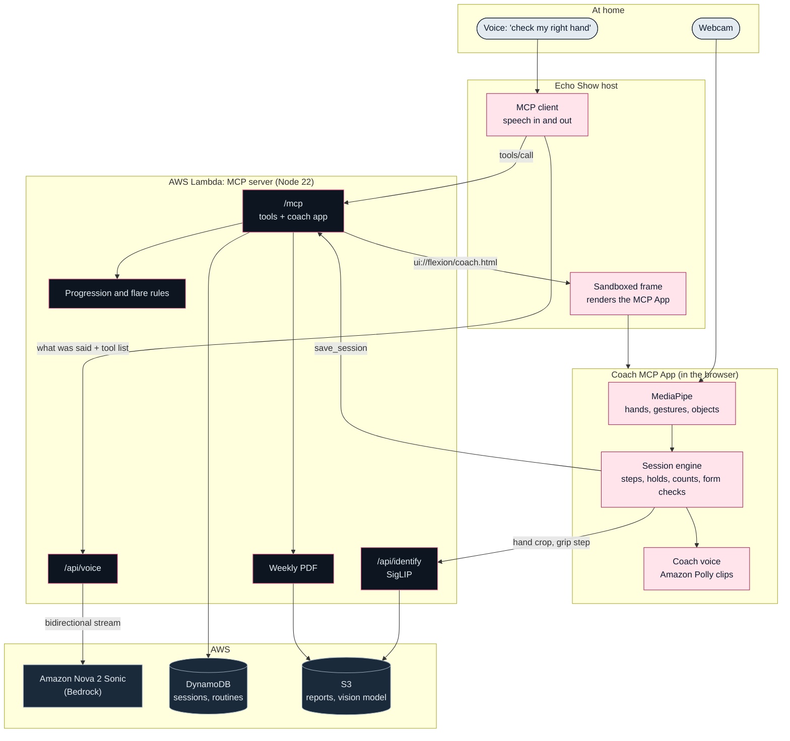
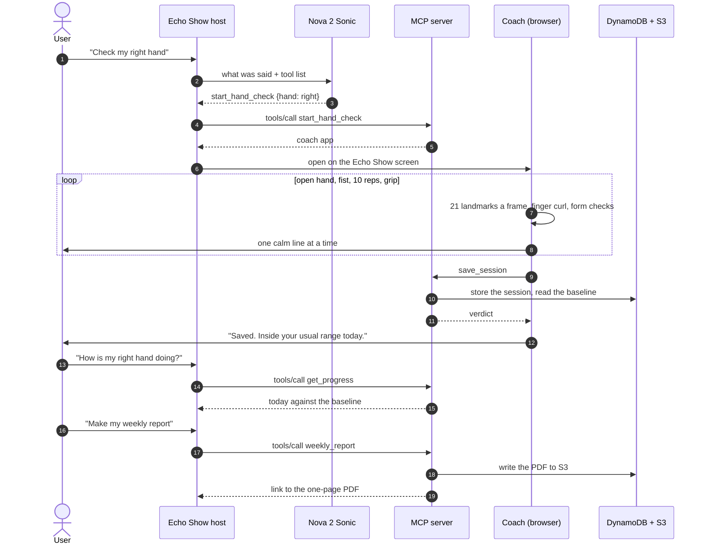

# FLEXION
### Alexa-led hand therapy check-ins with webcam range-of-motion measurement


-059669?style=for-the-badge)


> *"Home hand exercises happen blind. Flexion gives them eyes."*

**[Live Site](https://main.d171bf7qqki4nj.amplifyapp.com/)** • **[Echo Show Simulator](https://ajsz3ao7tetyacjcyputpsz2mm0edogp.lambda-url.us-east-1.on.aws/host/index.html)** • **[How We Measure](https://main.d171bf7qqki4nj.amplifyapp.com/method.html)**

---

## Executive Summary

**Flexion** is a two-minute morning hand check for people recovering from a hand injury or surgery, built for the
**Build, Ship, Shape: Amazon Developer Hackathon (Alexa+ track)**. The user says "check my right hand"; Amazon Nova 2
Sonic picks the tool, the MCP server opens a coach on the Echo Show screen, and the coach talks them through an open
hand, a fist, ten reps and a grip task in a calm Amazon Polly voice while the webcam measures every finger.

Hand tracking runs in the browser at **30 fps, 3 to 5 ms a frame**, reading **21 landmarks per hand**. A change only
counts when it leaves the measured noise band: **10.7 %** of the open-to-fist range over 10 repeated fists. The routine
only grows inside the limits the therapist wrote, and every week the therapist gets a one-page PDF.

---

## System Architecture & Workflow



---

## End-to-End Hand Check Sequence



---

## Measurement & Statistical Gates

The fist reading uses plain 2D webcam coordinates:

$$
r_{\text{fist}} = \frac{\lVert p_{\text{index tip}} - p_{\text{index knuckle}} \rVert}{\lVert p_{\text{wrist}} - p_{\text{middle knuckle}} \rVert}
$$

| Form check | Rule | Spoken fix |
|:---|:---|:---|
| Palm faces the camera | knuckle width ÷ palm length ≥ 0.45 | "Turn your palm to face me." |
| Thumb outside the fist | thumb tip to little knuckle ÷ palm length ≥ 0.6 | "Thumb across the outside." |

| Validation run 4 (`spike/day1/data`) | Value |
|:---|:---|
| Open hand | 0.766 |
| Fist, mean ± SD (n = 10) | 0.183 ± 0.023 |
| MDC95 = 1.96 × √2 × SD | **0.063** |
| Share of the open-to-fist range | **10.7 %** |

| Verdict after a session | Condition |
|:---|:---|
| Building | fewer than 3 earlier sessions (the baseline is their median) |
| Inside your usual range | change within ± MDC95 |
| Closed further | fist tighter than baseline − MDC95 |
| Looser | fist more open than baseline + MDC95 |

Progression: a target rises at most 10 % once a week, only after 3 completed pain-free sessions, and never past the
therapist's limit. A flare is a drop beyond MDC95 on 2 days in a row.

---

## Technology Stack & AWS Integrations

| Layer | Technology | Role |
|:---|:---|:---|
| **Voice** | **Amazon Nova 2 Sonic** (Bedrock bidirectional stream) | Picks the MCP tool from free speech; answers questions during a session. |
| **Coach voice** | **Amazon Polly** (generative, Ruth) | 42 pre-rendered coach lines. |
| **Hosting** | **AWS Lambda** + Web Adapter + Function URL | MCP server, voice and identify routes (Node 22, 2048 MB). |
| **Storage** | **Amazon DynamoDB** + **Amazon S3** | Sessions and routines; report PDFs and the vision model. |
| **Site** | **AWS Amplify Hosting** | The public site with the live camera demo. |
| **Ops** | **Amazon EventBridge**, **CloudWatch**, **AWS Budgets** | Keep-warm ping every 4 minutes, logs, $10 a month alarm. |
| **Hand tracking** | **MediaPipe** HandLandmarker, GestureRecognizer, ObjectDetector | 21 landmarks per hand in the browser on the GPU. |
| **Object check** | **SigLIP** base patch16-224 on onnxruntime-node | Names the object in the hand from 282 labels. |
| **Protocol** | **MCP SDK v2** + **MCP Apps** | Tools over Streamable HTTP; the coach ships as `ui://flexion/coach.html`. |
| **Site front end** | **Vite**, **three.js**, **GSAP**, **Lenis** | The acrylic hand, dial and scroll scenes. |

---

## MCP Tools & API Endpoints

Base URL: `https://ajsz3ao7tetyacjcyputpsz2mm0edogp.lambda-url.us-east-1.on.aws`

| Tool | Called by | Input | Result |
|:---|:---|:---|:---|
| `start_hand_check` | the model | `{ hand }` | opens the coach app |
| `get_progress` | the model | `{ hand }` | today against the baseline, noise or real change, streak, flare |
| `weekly_report` | the model | `{ hand, days }` | link to the one-page therapist PDF |
| `save_session` | the coach app | session log | stores it and returns the verdict |
| `identify_object` | the coach app | 224 × 224 hand crop | `{ label, confidence, matchesExpect }` |
| `ping` | the model | none | health check |

| Endpoint | Method | Response Type | Description |
|:---|:---|:---|:---|
| `/mcp` | `POST` | `application/json`, `text/event-stream` | MCP over Streamable HTTP (for MCP clients, not a browser page). |
| `/api/voice` | `POST` | `application/json` | One Nova 2 Sonic turn: picks a tool or answers in two short sentences. |
| `/api/identify` | `POST` | `application/json` | SigLIP object check for the grip step. |
| `/api/session` | `POST` | `application/json` | Saves a session from the standalone coach page. |
| `/files/{key}` | `GET` | `application/pdf` | Report PDFs. |
| `/host/index.html` | `GET` | `text/html` | The Echo Show simulator. |
| `/app/index.html` | `GET` | `text/html` | The coach on its own. |
| `/healthz` | `GET` | `text/plain` | Health check. |

---

## Local Installation & Quick Start

You need **Node.js 22.18 or newer**, and **Chrome or Edge** with a webcam for the camera parts.

### 1. Clone Repository
```bash
git clone https://github.com/omshukla24/flexion.git
cd flexion
```

### 2. Install and Test the Server
```bash
cd server
npm install
npm test
```

### 3. Launch the Server
```bash
npm start
```
Open **`http://127.0.0.1:3001`** in Chrome. It opens the Echo Show simulator. Click "check my hand", or tick
"Scripted hand" to run a whole session without a camera. The coach on its own is at **`http://127.0.0.1:3001/app/index.html`**.
Sessions are saved as JSON in `server/.data/`.

### 4. Configure Environment (Optional)
```bash
# Let Nova 2 Sonic pick the tools (AWS credentials with Bedrock access in us-east-1)
aws configure

# Name objects on the server in the grip step (SigLIP vision model, Xenova/siglip-base-patch16-224)
export FLEXION_SIGLIP_MODEL=/path/to/onnx/vision_model_quantized.onnx

# Use DynamoDB and S3 instead of local files
export FLEXION_TABLE=flexion
export FLEXION_BUCKET=<your bucket>
```

### 5. Run the Site
```bash
cd ../site
npm install
npm test
npm run dev
```
Vite prints the local address. `npm run build` writes the production site to `site/dist/`.

### 6. Deploy to AWS (Optional)
```bash
cd ../server
node scripts/deploy.mjs                 # prints the plan, changes nothing
node scripts/deploy.mjs --yes           # DynamoDB, S3, Lambda + URL, keep-warm, Amplify site, budget
node scripts/deploy.mjs --yes --server-only
node scripts/deploy.mjs --yes --site-only
```

---

## Reproducible Testing Instructions

The server suite covers the session engine, form checks, voice lines, talk-back, verdicts, progression and flares, the
store, the report PDFs, the MCP tools and routes, rate limits, the Sonic stream and identify scoring:

```bash
cd server
npm test
```

```text
ℹ tests 187
ℹ suites 2
ℹ pass 186
ℹ fail 0
ℹ cancelled 0
ℹ skipped 1
ℹ todo 0
ℹ duration_ms 1192
```

The skipped test runs the real SigLIP model on private photos and needs `FLEXION_SIGLIP_MODEL`.

The site suite covers the hand pose, noise band, fence and report maths, the needle field, the scene transitions and
the live camera labels:

```bash
cd site
npm test
```

```text
ℹ tests 43
ℹ pass 43
ℹ fail 0
ℹ duration_ms 116
```

Check the live MCP endpoint (ping and `get_progress`, 50 rounds, p50 and p95):

```bash
cd server
npm run latency -- https://ajsz3ao7tetyacjcyputpsz2mm0edogp.lambda-url.us-east-1.on.aws/mcp 50
```

---

## Repository Structure

```
flexion/
├── server/
│   ├── src/
│   │   ├── server.js            # HTTP routes
│   │   ├── flexion.js           # MCP tools and the coach app resource
│   │   ├── routine.js           # progression inside the therapist's limits, flare check
│   │   ├── report.js            # weekly therapist PDF
│   │   ├── store.js             # local JSON, or DynamoDB + S3
│   │   ├── voice.js             # Amazon Nova 2 Sonic stream
│   │   ├── identify.js          # SigLIP on onnxruntime-node
│   │   ├── identify-core.js     # label scoring
│   │   ├── identify-labels.json # 282 label embeddings
│   │   └── limit.js             # rate limits
│   ├── app/                     # the coach (browser)
│   │   ├── vision.js            # MediaPipe models and the camera loop
│   │   ├── vision-core.js       # finger curl, fist reading, form checks
│   │   ├── session-core.js      # session steps, holds and counts
│   │   ├── speaker.js           # plays the coach's lines one at a time
│   │   ├── talk.js              # "wait", "it hurts", "slower" and questions
│   │   ├── session-report.js    # one session's PDF
│   │   ├── lines.js             # every line the coach can say
│   │   └── voice/               # Amazon Polly clips
│   ├── host/                    # Echo Show simulator
│   ├── scripts/                 # deploy, latency check, sample PDFs
│   └── test/                    # 16 test files
├── site/
│   ├── index.html, method.html, 404.html
│   ├── src/core/                # scroll, loader, transitions, cursor, navigation
│   ├── src/scenes/              # hand and dial, noise band, fence, grip, report, live camera
│   ├── public/                  # fonts, sample PDFs, images
│   └── tests/                   # 6 test files
├── spike/day1/                  # first measurement tests and raw runs (data/*.csv)
└── tools/
    ├── siglip/                  # builds the label embeddings
    └── voice/                   # renders the coach lines with Amazon Polly
```

---

## License & Author

* **Author**: Om Shukla
* **Project**: Flexion
* **Contest**: Build, Ship, Shape: Amazon Developer Hackathon, Alexa+ track
* **License**: Apache License 2.0 (fonts under the SIL Open Font License)
